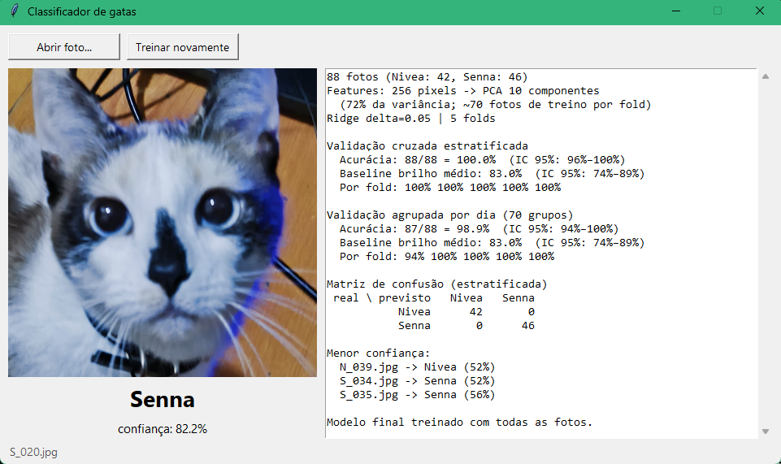
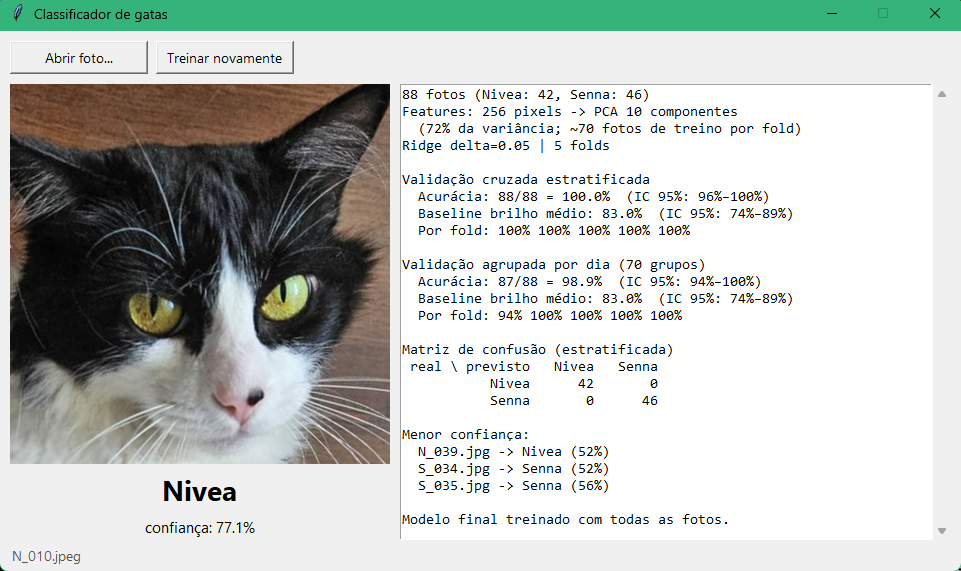

# Classificador binário de fotos — Nivea x Senna

Regressão logística implementada do zero em NumPy, que identifica qual das duas
gatas aparece numa foto. O projeto nasceu como estudo de classificação binária:
nenhuma biblioteca de machine learning é usada — sigmoide, log loss, gradiente,
regularização, PCA, validação cruzada e métricas são todos código do repositório.



## Resultados

88 fotos (Nivea: 42, Senna: 46), avaliadas com validação cruzada de 5 folds.

| Avaliação | Acurácia | IC 95% (Wilson) |
| --- | --- | --- |
| Validação cruzada estratificada | 88/88 = 100% | 96%–100% |
| Agrupada por dia da foto | 87/88 = 98,9% | 94%–100% |
| Baseline: só o brilho médio | 73/88 = 83% | 74%–89% |

O que esses números escondem, e por que vale olhar com ceticismo:

- **O conjunto é pequeno.** Mesmo acertando tudo, o intervalo de confiança vai
  até 96% no limite inferior. "100%" aqui não significa "nunca erra".
- **Fotos parecidas inflam o resultado.** Fotos do mesmo dia são quase cópias
  uma da outra. Por isso existe a segunda avaliação, em que todas as fotos de um
  mesmo dia ficam no mesmo fold: o acerto cai para 98,9%.
- **A tarefa é mais fácil do que parece.** Uma das gatas é escura e a outra é
  clara, tanto que olhar só o brilho médio já acerta 83%. O modelo provavelmente
  aprende "gata escura x gata clara", não a identidade de cada uma.
- **Há casos no limite.** A foto `N_039.jpg` é classificada com 52% de
  confiança, ou seja, no fio da navalha.

## Como funciona

```
foto -> miniatura 16x16 em tons de cinza (256 pixels)
     -> PCA (10 componentes, 72% da variância)
     -> padronização (média 0, desvio 1)
     -> regressão logística com penalidade ridge
```

O ponto central é que o classificador recebe **10 números por foto**, com cerca
de 70 fotos de treino em cada fold. Menos parâmetros do que amostras, para o
modelo não conseguir simplesmente decorar o conjunto de treino.

O PCA e a padronização são ajustados **dentro de cada fold**, usando apenas as
fotos de treino daquele fold. Se fossem ajustados antes da divisão, as fotos de
teste influenciariam as features com que são avaliadas, e o resultado seria
otimista.

A avaliação roda duas vezes, com dois esquemas de divisão:

- **Estratificada:** cada fold mantém a proporção entre as duas classes.
- **Agrupada por sessão:** fotos tiradas no mesmo dia (data lida do EXIF) ficam
  sempre no mesmo fold, então uma foto quase idêntica nunca fica no treino
  enquanto sua irmã está no teste.

## Como rodar

```bash
pip install -r requirements.txt
```

As fotos não fazem parte do repositório. Monte uma pasta por classe:

```
suas-fotos/
├── Nivea/   # label 0
└── Senna/   # label 1
```

Aponte o programa para ela com `--data-dir` (ou a variável de ambiente
`CATS_DATA_DIR`); o padrão é a pasta acima do repositório. Para outros nomes de
pasta, use `--classes GATO_A GATO_B`.

```bash
python cats.py train --data-dir suas-fotos   # valida, treina e salva o modelo
python cats.py --data-dir suas-fotos         # abre a interface
python cats.py predict foto1.jpg foto2.jpg   # classifica pelo terminal
```

O `train` aceita ainda `--folds`, `--components`, `--delta` e `--seed`.

## A interface

Abre uma janela onde você escolhe uma foto e vê o palpite do modelo, com a
confiança, ao lado do relatório da última validação cruzada. O botão
"Treinar novamente" refaz a avaliação e o modelo numa thread separada, sem
travar a janela. Se não houver modelo salvo, ela treina sozinha ao abrir.



## Estrutura

```
binary_classifier/
├── core.py            sigmoide, logit, log loss e seus gradientes, ridge e lasso
├── train.py           ClassifierFit: gradiente descendente em mini-batches
├── decomposition.py   PCA via SVD
├── preprocessing.py   padronização e divisão treino/teste
├── model_selection.py folds estratificados e agrupados
├── metrics.py         acurácia, precisão, recall, F1, intervalo de Wilson
├── images.py          leitura de imagens para arrays de tamanho fixo
├── features.py        miniaturas e agrupamento por data do EXIF
├── pipeline.py        junta tudo: treino, validação cruzada, salvar/carregar
├── plotting.py        métricas em função do limiar de decisão
└── gui.py             a janela em Tkinter

cats.py                classificador das fotos (treino, predição, interface)
main.py                exemplo anterior: dataset de arroz (Cammeo x Osmancik)
tests/                 92 testes
```

## Testes

```bash
python -m pytest
```

## Próximos passos

- Comparar com outros classificadores: KNN, Naive Bayes, perceptron.
- Testar com fotos novas, tiradas depois do treino — o argumento mais honesto
  de que o modelo generaliza.
- Features que não dependam tanto de cor e brilho, para o modelo distinguir as
  gatas e não só claro de escuro.
